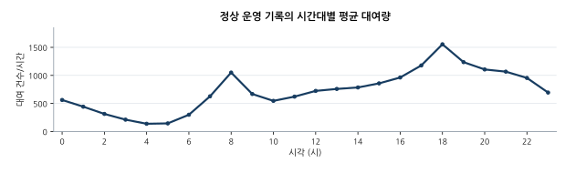
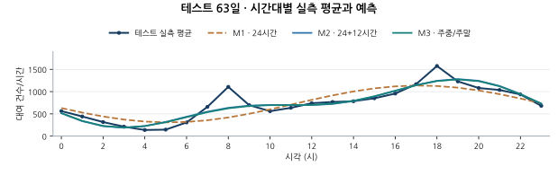
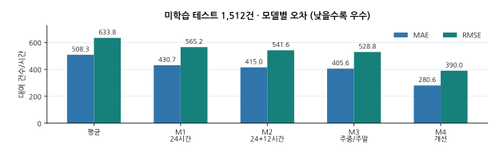
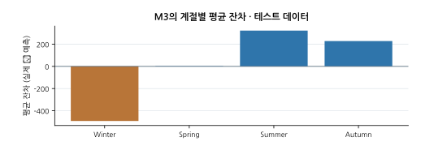

# Seoul Bike Demand — Fourier Regression with Linear Algebra

## 보고서 · 그래프 · 제출 자료

- **[최신 90점 기준 분석 정리 (Markdown)](report/rubric_90_complete.md)** — M1~M4의 정확한 식, 예측값, 계절별 편향·분산 분석, 한계 및 자기평가.
- **[Matplotlib 그래프 4종](results/figures)** — 실제 원본 CSV에서 다시 계산한 PNG·SVG·벡터 PDF.
- **[검증된 분석 지표](results/figures/report_model_scores.csv)** — 평균모델과 M1~M4의 MAE·RMSE·R².
- **[기존 제출용 PDF](submission/서울_공공자전거_수학적모델링_탐구보고서.pdf)** · **[기존 편집용 DOCX](submission/서울_공공자전거_수학적모델링_탐구보고서.docx)**

> **문서 버전 주의:** 위 \`submission/\` PDF·DOCX는 이전 형식으로 생성된 버전이며,
> 최근 90점 기준의 M4 및 보강된 성찰까지 담은 **최신 보고서와 동일하지 않다**.
> 최신 분석 내용은 \`report/rubric_90_complete.md\`가 기준이다. 오래된 PDF를 최신 제출본으로 착각하지 않도록 명시한다.
> PDF/DOCX 자동 생성기는 의도치 않은 덮어쓰기를 막기 위해 수동 실행만 지원한다.
>
> 저장소는 **Public**이다. 제출 파일에 학번과 이름이 포함되어 있으므로 공개 범위를 확인해야 한다.

서울 공공자전거 시간별 대여량을 **24시간 및 12시간 주기의 삼각함수**로 모델링하고,
행렬의 최소제곱법으로 계수를 구한 뒤 미관측 날짜의 오차를 비교하는 탐구 프로젝트입니다.

## M4: 계절·기상 조건을 이용한 개선 모델 (2026-10)

기존 M3의 10개 푸리에/주말 회귀계수와 추가 변수 6개(기온/10, 강수량/10, 공휴일, 봄·여름·가을 더미)의 **16개 계수를 모두 새로 최소제곱 추정**합니다. 검증 집합에서 λ ∈ {0, 1, 10, 100, 1000}을 비교해 **λ=0**을 선택했으며, 테스트 결과는 MAE **280.575**, RMSE **389.954**, R² **0.6213**입니다. 날짜 단위 분할과 학습/검증/테스트 수는 M1~M3과 동일합니다.

- 실행: `python -m src.improved_model`
- 계산 코드: [src/improved_model.py](src/improved_model.py)
- 실제 M4 계수: [results/improved_coefficients.csv](results/improved_coefficients.csv)
- 실행 시 생성: `results/improved_validation.csv`, `results/improved_group_errors.csv`
- 결과는 **관측된 기상 정보가 주어졌을 때 해당 날짜의 수요를 추정**한 것입니다. 미래의 미관측 기상을 예측한 결과는 아닙니다.

## 검증된 데이터

- **출처:** UCI Machine Learning Repository, [Seoul Bike Sharing Demand](https://archive.ics.uci.edu/dataset/560/seoul+bike+sharing+demand).
- **DOI:** https://doi.org/10.24432/C5F62R
- **이용 조건:** [CC BY 4.0](https://creativecommons.org/licenses/by/4.0/) — 출처를 명시해야 합니다.
- **기간:** 2017-12-01 ~ 2018-11-30
- **원본:** 8,760행, 14개 열(시간별 대여 건수 및 날씨·공휴일 등).
- **전처리:** `Functioning Day = No` 295행 제외 → 8,465행.
- **보존 자료:** [data/SeoulBikeData.csv](data/SeoulBikeData.csv). UCI의 공개 자료를 동일한 이름으로 배포한 [공개 GitHub 사본](https://github.com/Itskindastrange/Seoul-Bike-Sharing-Demand-UCI-Dataset)에서 복사했습니다. 데이터 내용은 수정하지 않았습니다.

## 분석한 수학적 모델

시간 `t ∈ {0, …, 23}`, 실제 시간당 대여 건수 `y`, 주말 여부 `w ∈ {0, 1}`.

- **Baseline:** 학습 데이터 전체의 평균 대여량만 예측.
- **M1 (24h):** `ŷ = a0 + a1 sin(2πt/24) + b1 cos(2πt/24)`.
- **M2 (24h + 12h):** M1에 `a2 sin(4πt/24) + b2 cos(4πt/24)` 추가.
- **M3 (주말 상호작용):** M2와 동일한 5개 기저함수 + 주말 지표와의 곱 5개로 **10개 계수를 새로 학습**. M2의 계수를 그대로 재사용하지 않음.
- **M4 (기상·계절):** M3의 10개 계수 + 관측 기온·강수량·공휴일·계절 더미 6개를 **16개 모두 다시 학습**. `λ=0`이 검증 RMSE에서 최적.

각 행은 한 시각의 삼각함수값으로 이루어진 설계행렬 `X`를 만들고,
`min ||Xβ-y||²`를 푸는 **선형 최소제곱법**(`numpy.linalg.lstsq`)으로 회귀계수를 얻습니다.
삼각함수가 포함되어 있어도 **계수에 대해 선형**인 모델입니다.

## 실행 (Windows PowerShell / macOS / Linux)

Python 3.10 이상이 필요합니다.

```powershell
git clone https://github.com/aether0xff-afk/LinearAlgebra_Seoul_bike.git
cd LinearAlgebra_Seoul_bike
python -m venv .venv
.\.venv\Scripts\Activate.ps1
python -m pip install -r requirements.txt
python -m src.run_analysis
python -m src.improved_model
python -m scripts.plot_report_figures
python -m unittest discover -s tests -v
```

macOS/Linux에서는 가상환경 활성화 명령을 `source .venv/bin/activate`로 바꾸세요.
PowerShell 실행 정책에서 활성화를 차단하면 `.\.venv\Scripts\python.exe -m pip install -r requirements.txt`,
`.\.venv\Scripts\python.exe -m src.run_analysis`처럼 가상환경 파이썬을 직접 호출할 수 있습니다.

옵션: `python -m src.run_analysis --data data/SeoulBikeData.csv --out results --seed 42`

### 자동 생성 결과

- `results/metrics.csv` — 학습/검증/테스트 MAE, RMSE, R².
- `results/coefficients.csv` — 학습 데이터에서 추정된 각 삼각함수의 계수.
- `results/hourly_means.csv` — 전체 정상 운영 기록의 시각별 표본수와 평균.
- `results/predictions.csv` — 각 원자료 행의 실제값/모델 예측값(실행 시 생성).
- `results/test_residuals_by_hour.csv` — 테스트 잔차의 시각별 평균.
- `results/figures/*.png` — 데이터 경향·주중/주말 곡선·MAE 비교·잔차 그래프(실행 시 생성).
- `results/summary.md` — 실행 결과의 간단한 표와 개선율.

일부 표 및 SVG 그래프는 저장소에 미리 제공됩니다. PNG와 행별 예측치는 명령 실행으로 재생성됩니다.

## 테스트 데이터 결과 (seed=42)

| Model | Test MAE | Test RMSE | Test R² |
|---|---:|---:|---:|
| Mean baseline | 508.296 | 633.756 | -0.000 |
| 24h | 430.716 | 565.230 | 0.204 |
| 24h + 12h | 414.978 | 541.564 | 0.270 |
| 24h + 12h + weekend interaction | **405.584** | **528.761** | **0.304** |

- **24h → 24h+12h MAE 감소:** 약 **3.65%**.
- **시간대별 전체 평균:** 오전 8시 약 1,050건, 오후 18시 약 1,554건.
- 수치 단위: 대여 건수/시간. 작을수록 MAE/RMSE가 좋습니다.
- **중요:** 이 수치는 **원자료가 존재하는 1년 안에서 보지 않은 날짜**를 맞히는 실험입니다. 다른 연도 예측 결과가 아닙니다.

### 최신 보고서용 그래프

실제 데이터와 학습 결과를 통해 생성한 그림이야. 사람이 그리거나 AI로 생성한 대략적인 선이 아니라,
\`scripts/plot_report_figures.py\`가 원본 CSV와 회귀계수에서 **다시 계산한 수치**로 그린다.









## 평가 설계와 한계

날짜별로 `season × weekend` 층을 구분하고, `date|seed`의 FNV-1a 해시로
정렬해 각 층의 약 70%를 훈련, 15%를 검증, 나머지를 테스트로 배정합니다.
같은 날짜의 24시간 기록이 서로 다른 데이터셋에 섞이지 않습니다.

**실제 관측 353일** 가운데 훈련 243일(5,832시간), 검증 47일(1,121시간),
테스트 63일(1,512시간)입니다. 일부 날짜는 미운영 시간이 있어 24개보다 적습니다.

- M1~M3은 시간 및 주말만 사용했고, M4는 관측 기온·강수량·공휴일·계절 변수를 함께 사용했습니다.
- M4는 해당 시점의 기상 관측값을 알고 있을 때의 **조건부 수요 예측**입니다. 미래 날씨까지 예측하지 않습니다.
- M3의 테스트 잔차를 참고해 M4 변수를 선택했으므로 M4 테스트 성능은 완전히 독립적인 최종 검증으로 보지 않습니다.
- 주기함수는 대여량을 음수로 예측할 수도 있으므로 운영용 예측 시스템으로 쓰려면 제약을 검토해야 합니다.
- 더 복잡한 모델의 학습 오차는 낮아지더라도 일반화 오차가 반드시 개선되지는 않습니다.
- 순수한 미래 예측을 평가하려면 **시간순 분할 또는 다른 연도 자료**가 추가로 필요합니다.

최신 수식, 잔차 분석, 자기평가는 [90점 기준 분석 보고서](report/rubric_90_complete.md)를 기준으로 확인하세요. 이전 버전의 기록은 [report/analysis.md](report/analysis.md)에 남겨두었습니다.
