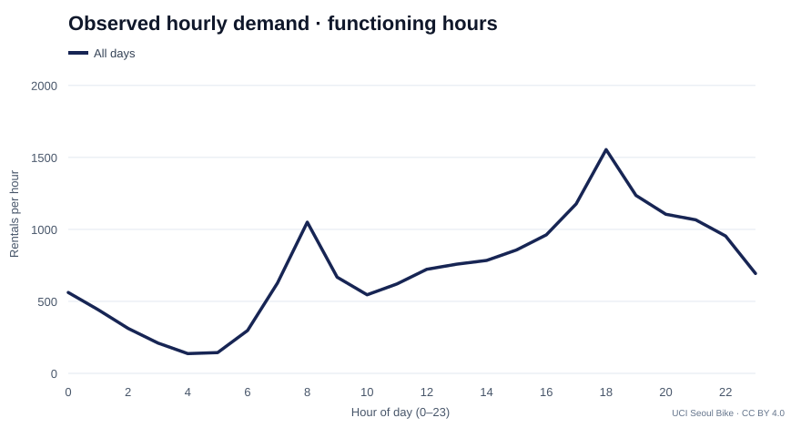
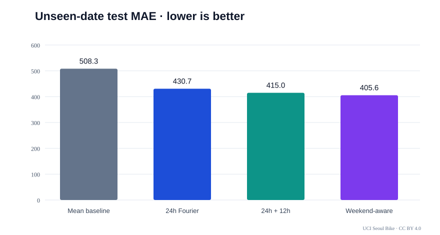
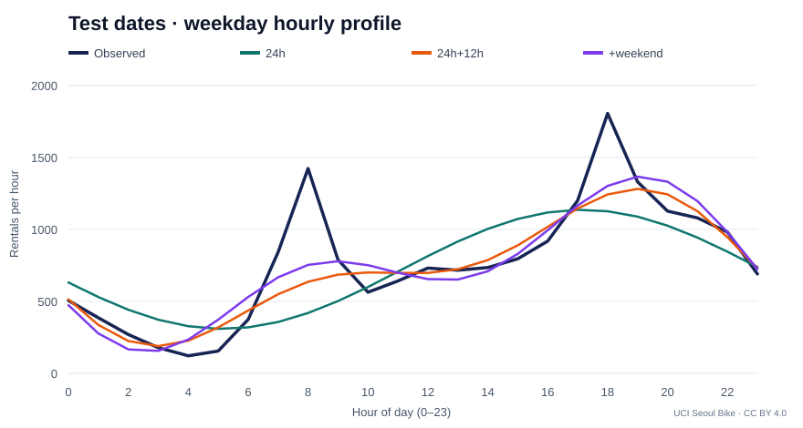
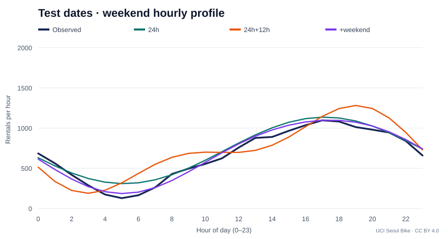

# 수학적 모델링 탐구 보고서

**학번 / 이름:** (제출할 때 직접 기입)  
**탐구 주제:** 서울시 공공자전거 대여량의 시간적 주기성과 푸리에 회귀모델의 예측 정확도 비교

**데이터 출처:** UCI Machine Learning Repository, *Seoul Bike Sharing Demand* (2020).  
https://archive.ics.uci.edu/dataset/560/seoul+bike+sharing+demand  
DOI: https://doi.org/10.24432/C5F62R  
라이선스: CC BY 4.0, 출처 표기 후 재배포·수정 허용.

**데이터 표본 수:** 원본 n = **8,760개**(시간별 기록). 미운영 295개 제외 후 실제 분석 n = **8,465개**.  
**기간:** 2017-12-01 ~ 2018-11-30, 서울 공공자전거 대여 건수와 기상·공휴일 정보.

---

## 1. 수집한 데이터 정리 및 시각화

### 1-1. 데이터 정리

원본 CSV에는 날짜, 시각, 대여 건수, 온도, 습도, 풍속, 강수량, 공휴일 여부,
운영 여부 등이 있다. 시각(`Hour`)을 독립변수로, 시간당 대여 건수
(`Rented Bike Count`)를 종속변수로 선정했다.
`Functioning Day = No`는 자전거 대여가 불가능한 상황이므로
수요 패턴을 왜곡하지 않도록 별도로 세어 제거했다.

- 원본: **8,760개**
- 미운영: **295개**
- 정상 운영: **8,465개**
- 사용 기간: **365일 중 정상 운영 관측이 남아 있는 353일**
- 날짜·시각 중복 여부, 결측치 및 데이터 타입을 코드로 확인하도록 구성했다.

### 1-2. 시간대별 그래프

정상 운영 기록 전체에서 시간대별 평균을 계산하면 오전 8시에는 약
**1,050.2건/시간**, 오후 18시에는 약 **1,554.0건/시간**이 관측된다.
반면 오전 4시에는 약 **137.5건/시간**에 그친다.
시간에 따른 반복적인 수요 차이가 크며, 한 번의 하루 주기만으로는
출근과 퇴근 부근의 두 상승 구간을 충분히 설명하기 어려울 가능성이 있다.

### 1-3. 학습과 평가 데이터 분리

데이터를 날짜 단위로 분할하고 계절·주말 여부별 층을 만들어 분할 비율의
불균형을 줄였다. 동일한 날짜는 반드시 한 그룹에만 속한다.
날짜 문자열과 고정 시드(42)의 FNV-1a 해시를 이용하므로 실행할 때마다
동일한 분할이 재현된다.

| 그룹 | 날짜 수 | 시간별 기록 수 |
|:---|---:|---:|
| 학습 | 243일 | 5,832개 |
| 검증 | 47일 | 1,121개 |
| 테스트 | 63일 | 1,512개 |
| **합계** | **353일** | **8,465개** |

분할 비율은 계절×주말의 각 층에서 정수로 나누므로 정확히 70:15:15는 아니다.
이 결과는 **해당 1년 안에서 관측하지 않은 날의 수요를 예측**하는 실험이며,
미래 연도를 예측하는 시계열 외삽 실험과는 다르다.

## 2. 수학적 모델링 및 예측값 도출

### 2-1. 주기함수로 대여량 근사

시간을 \(t\in\{0,1,\dots,23\}\), 실제 대여량을 \(y\)라 두었다.

**모델 1: 24시간 주기**

\[
\hat y_1(t)=a_0+
a_1\sin\left(\frac{2\pi t}{24}\right)+
b_1\cos\left(\frac{2\pi t}{24}\right).
\]

**모델 2: 12시간 주기 추가**

\[
\begin{aligned}
\hat y_2(t)= {}& a_0+
a_1\sin\left(\frac{2\pi t}{24}\right)+
b_1\cos\left(\frac{2\pi t}{24}\right)\\
&+a_2\sin\left(\frac{4\pi t}{24}\right)+
b_2\cos\left(\frac{4\pi t}{24}\right).
\end{aligned}
\]

**모델 3: 주말과 주중의 서로 다른 파형**

\(w=0\)이면 주중, \(w=1\)이면 주말로 정의한다.

\[
\hat y_3(t,w)=\hat y_2(t)+w\left[
c_0+c_1\sin\frac{2\pi t}{24}+d_1\cos\frac{2\pi t}{24}
+c_2\sin\frac{4\pi t}{24}+d_2\cos\frac{4\pi t}{24}
\right].
\]

즉 모델 3은 주중 함수에 주말 차이 함수를 더하는 형태다.
모델 1·2·3의 추정 계수는 각각 3·5·10개이며, 비교 기준으로
학습 구간 평균만 출력하는 상수 모델도 추가했다.

### 2-2. 선형대수와 최소제곱법

각 데이터의 삼각함수 계산 결과를 하나의 행으로 놓으면

\[
X=
\begin{bmatrix}
1 & \sin\frac{2\pi t_1}{24} & \cos\frac{2\pi t_1}{24} & \cdots\\
1 & \sin\frac{2\pi t_2}{24} & \cos\frac{2\pi t_2}{24} & \cdots\\
\vdots&\vdots&\vdots&\ddots
\end{bmatrix},\qquad
\boldsymbol\beta=
\begin{bmatrix}a_0&a_1&b_1&\cdots\end{bmatrix}^{\mathsf T}.
\]

모델은 \(X\boldsymbol\beta\approx\mathbf y\)가 된다.
실제값과 예측값의 차이 제곱합

\[
S(\boldsymbol\beta)=\|X\boldsymbol\beta-\mathbf y\|_2^2
\]

를 최소로 하는 계수를 구했다. \(X\)가 열 전체 계수를 가질 때
정규방정식 \(X^{\mathsf T}X\boldsymbol\beta=X^{\mathsf T}\mathbf y\)를
통해 이론적 해를 설명할 수 있다. **계산에는 역행렬을 직접 구하는 대신
`numpy.linalg.lstsq`를 사용했다.**
삼각함수가 들어가지만 계수에 관해서는 선형모델이므로
선형대수의 최소제곱법으로 풀 수 있다.

### 2-3. 실제 추정한 계수

학습 데이터에서 모델 2의 계수를 추정한 결과는 다음과 같다.

| 계수 | 값 |
|---|---:|
| \(a_0\) | 722.7805 |
| \(a_1\) | -403.3947 |
| \(b_1\) | -91.7214 |
| \(a_2\) | -183.4257 |
| \(b_2\) | -116.9340 |

주기 성분의 진폭을 계산하면

\[
A_{24}=\sqrt{a_1^2+b_1^2}\approx 413.69,\qquad
A_{12}=\sqrt{a_2^2+b_2^2}\approx217.53.
\]

따라서 \(A_{12}/A_{24}\approx0.526\)이다. 이 값은 12시간
성분의 크기가 24시간 성분에 비해 작지 않음을 보여주지만,
그 자체가 예측 성능을 의미하지는 않는다.
정확한 전체 계수는 [coefficients.csv](../results/coefficients.csv)를 참고한다.

### 2-4. 테스트 날짜의 실제 예측값 예시

모델의 출력을 수치로 확인하기 위해 **테스트 데이터인 2017년 12월 2일(토요일)**의
실제값과 예측값 일부를 비교했다. 예측값은 해당 날짜의 데이터를 학습하지 않고
학습 그룹에서 구한 계수에 시각과 주말 여부를 대입하여 계산했다.

| 시각 | 실제 대여(건) | 모델 1 | 모델 2 | 모델 3 |
|---|---:|---:|---:|---:|
| 00시 | 328 | 631.059 | 514.125 | 614.071 |
| 04시 | 89 | 327.570 | 227.185 | 208.894 |
| 08시 | 219 | 419.291 | 636.609 | 347.717 |
| 18시 | 489 | 1126.175 | 1243.109 | 1096.290 |

이날 18시의 실제 수요는 평균적인 퇴근시간 패턴보다 작았다.
따라서 전체 테스트 MAE가 개선되더라도 개별 날짜에는 상당한 오차가 남을 수 있다.
시간별 24개 값은 [example_test_day.csv](../results/example_test_day.csv)에 기록했다.

## 3. 오차 분석, 모델 한계점 및 개선 방안

### 3-1. 오차 수식

실제값 \(y_i\), 예측값 \(\hat y_i\), 테스트 관측 수 \(n\)에 대해

\[
\mathrm{MAE}=\frac1n\sum_{i=1}^{n}|y_i-\hat y_i|,
\qquad
\mathrm{RMSE}=\sqrt{\frac1n\sum_{i=1}^{n}(y_i-\hat y_i)^2}.
\]

MAE는 평균적인 절대 오차 크기를 나타내고, RMSE는 큰 오차에
더 민감하다. 테스트 데이터는 계수를 구하는 데 사용하지 않았다.

### 3-2. 실제 테스트 결과

| 모델 | 테스트 MAE(건/시간) | 테스트 RMSE(건/시간) | 테스트 \(R^2\) |
|---|---:|---:|---:|
| 학습 평균만 예측 | 508.296 | 633.756 | -0.000 |
| 모델 1: 24시간 | 430.716 | 565.230 | 0.204 |
| 모델 2: 24시간+12시간 | 414.978 | 541.564 | 0.270 |
| 모델 3: 주말 상호작용 추가 | **405.584** | **528.761** | **0.304** |

모델 1에서 모델 2로 확장할 때 MAE 감소율은

\[
\frac{430.716-414.978}{430.716}\times100
\approx \boxed{3.65\%}.
\]

모델 1과 모델 3을 비교하면 약 **5.83%** 감소했다.
이는 실측 데이터를 바탕으로 검증한 수치이며, 그래프의 모양만 보고
모델의 우수성을 판단하지 않았다는 데 의의가 있다.

### 3-3. 테스트 날짜에서의 곡선 비교

두 그래프 모두 테스트 데이터의 주중/주말 시간대별 실제 평균과
훈련 데이터에서 얻은 각 모델 함숫값을 비교한다.

### 3-4. 한계와 수학적 개선

1. **날씨와 강수량의 영향 누락.** 단순 주기식은 비가 오는 날
   대여량이 급격히 달라지는 상황을 반영하지 못한다.
   개선하려면 기온 \(T\), 강수량 \(R\) 등 설명변수를 추가한
   다중회귀 \(\hat y=f(t,w)+\gamma_1T+\gamma_2R\)을 시험할 수 있다.
   이때 계수는 여전히 최소제곱법으로 구할 수 있다.
2. **계절별 주기성 변화.** 같은 18시라도 계절마다 일조시간이나
   이동 패턴이 다르므로 계절과 주기함수의 상호작용항을
   추가할 수 있다. 단, 계수가 늘어나 과적합할 수 있으므로
   검증/테스트 성능을 비교해야 한다.
3. **수요는 비음수·정수인데 회귀 예측은 실수.** 이 탐구의
   계수 선형회귀는 음수도 허용하므로 제한이 있다.
   비음수 제약 회귀나 로그 연결함수를 가진 포아송 회귀가
   후속 대안이다. 후자는 현재의 선형 최소제곱법과 다른
   추정 절차가 필요하다.
4. **한 해의 내부 분할이라는 한계.** 성능 지표는 동일 기간의
   관측하지 않은 날짜에 대한 일반화 결과일 뿐, 이듬해의
   수요를 예측하는 능력을 입증하지 못한다. 미래 성능을
   평가하려면 다음 연도 자료를 확보해 시간순으로 검증해야 한다.

## 4. 탐구 성찰 (자기 평가 초안)

처음에는 24시간마다 반복되는 현상이므로 하나의 사인함수만으로도
대여량 변화를 충분히 나타낼 수 있을 것이라 가정했다.
하지만 시간대별 그래프에서 오전과 오후에 서로 다른 상승
구간이 나타나는 것을 확인했고, 12시간 성분을 추가하는
모델을 세웠다. 실제 테스트에서는 MAE가 약 3.65% 감소했다.
따라서 직관적으로 그래프가 비슷해 보이는 것과 실제
예측 정확도는 구분해서 평가해야 함을 확인했다.

또한 같은 날짜의 관측값을 학습과 테스트에 동시에 넣지 않도록
분리함으로써 결과를 더 엄격하게 비교하려고 했다.
그럼에도 남아 있는 오차가 상당히 커서 시간대라는 한 변수만으로
현실의 자전거 대여량을 충분히 설명하지 못한다는 한계가 드러났다.
향후에는 강수량·기온·계절과의 상호작용을 추가한 뒤
동일한 테스트 조건에서 성능 변화가 실제로 나타나는지
검증할 필요가 있다.

> 이 항목은 제출용 자기평가 **초안**이며, 실제 직접 수행하고
> 해석한 과정에 맞춰 마지막 문장을 수정하는 것이 적절하다.

---

**재현 방법:** 저장소 루트에서 `python -m src.run_analysis` 실행.  
원시 관측값 및 계산용 코드는 `data/`, `src/`에 있고,
지표와 그림은 `results/`에 저장되어 있다.
